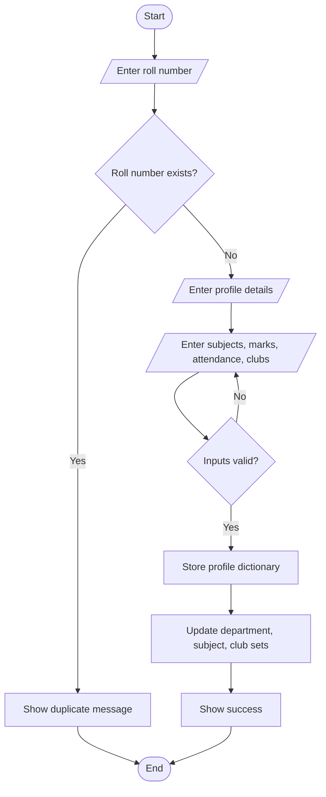
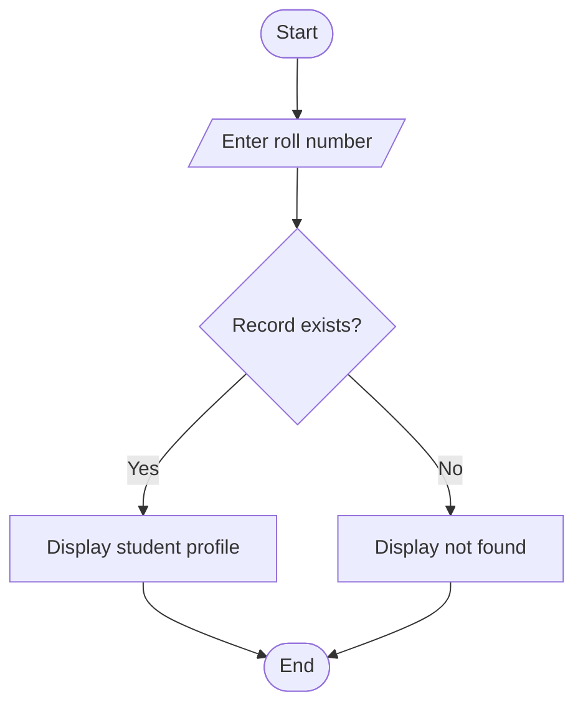
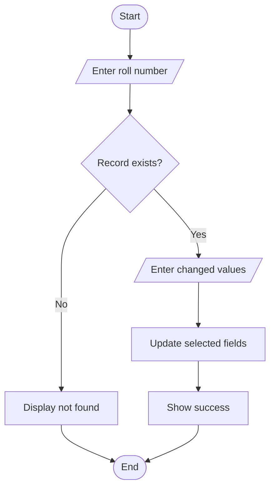
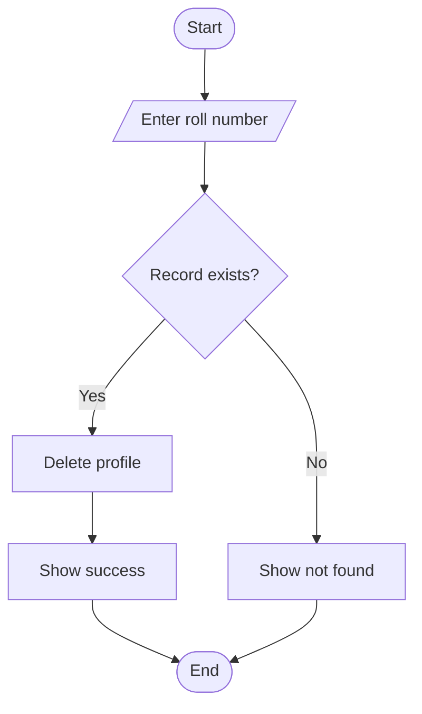
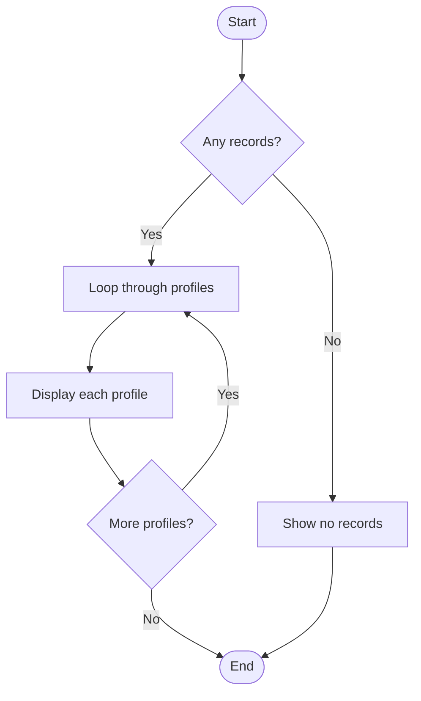
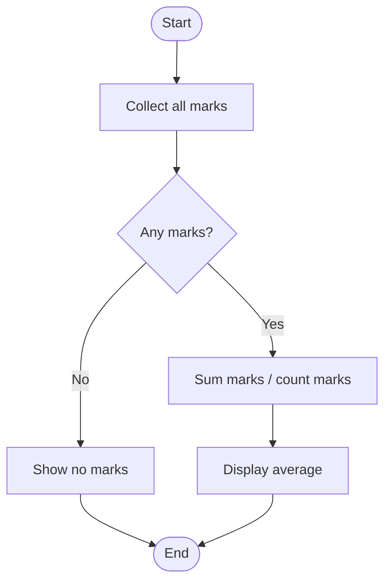
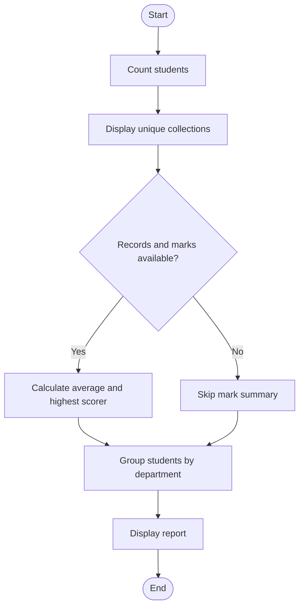

# Flowchart Collection

These Mermaid flowcharts can be viewed on GitHub. Each describes the main control flow of an operation.

## Add Student

## Search Student

## Update Record

## Delete Record

## Display Records

## Calculate Average

## Generate Report

